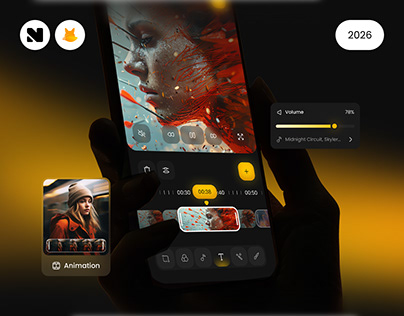

# Yellow Video Editor in Silhouette Hands

**Discipline:** app ·  · **Design style:** Dark & Neon
**Tags:** video-editor, yellow, black, silhouette, timeline, floating-cards, cover

## What it is
A cover with black silhouetted hands holding a phone with a dark video editing UI and a yellow timeline, plus floating volume and animation cards and a year pill.

## What it means
Black hands and a warm yellow glow keep focus on the editing controls, and floating cards explain features at a glance.

## Techniques
- Silhouetted hands merging with the dark background
- Yellow accent for playhead, buttons and glow
- Floating feature cards outside the phone
- Amber light leak from the left
- Small logo chips top left and year top right

## Best for
- Creative and video apps
- Dark portfolio covers
- Feature teaser images

## Vocabulary
- **Light leak** — A warm glow bleeding into the edge of an image.
- **Playhead** — The marker showing the current position on a timeline.
- **Feature float** — A UI card pulled outside the device to highlight a feature.
