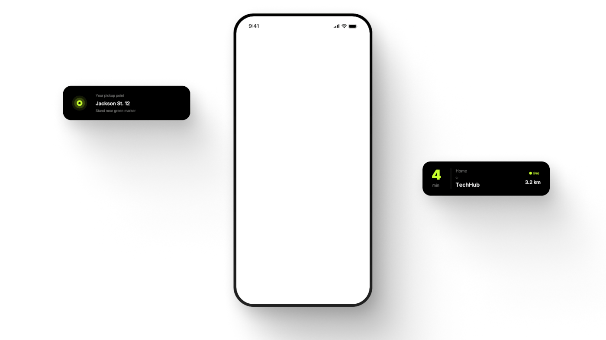

# Empty white phone flanked by black pickup and trip chips with lime accents

**Discipline:** app ·  · **Design style:** Dark & Neon
**Tags:** mockup, blank, chips, black, lime, white, shadows, animation-frame

## What it is
A white canvas with a blank white phone at the centre and two floating black rounded chips: a pickup point with a lime target icon at left and a 4-minute trip card with 'live' at right, all with long soft shadows.

## What it means
Minimal and staged; the empty screen is the start of an animation.

## Techniques
- Float dark chips beside a blank device.
- Use lime only for status.
- Cast long soft shadows.
- Show the frame before content appears.

## Best for
- Animated app reveals
- Feature callouts
- Minimal presentation frames

## Vocabulary
- **Floating chip** — A small UI card outside the device.
- **Blank device** — A phone without content.
- **Soft long shadow** — A diffuse shadow extending far from an object.
- **Status accent** — A colour used to signal live state.
