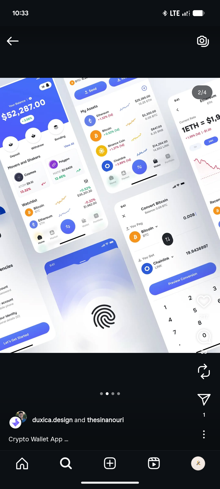

# Blue Crypto Wallet Screens with Fingerprint

**Discipline:** app ·  · **Design style:** Gradient & Aurora
**Tags:** crypto, wallet, blue, white, tilted, fingerprint, convert, assets

## What it is
A tilted collage of crypto wallet screens with a blue gradient balance header, movers and watchlist lists with coloured sparklines, an assets list, a blue fingerprint security screen and a Convert Bitcoin screen with a keypad and blue Preview Conversion button.

## What it means
Cobalt blue on white feels trustworthy, and the giant fingerprint makes security tangible.

## Techniques
- Blue gradient balance header
- Coloured sparklines per asset
- Large fingerprint graphic on the security screen
- Blue pill CTAs throughout
- Rotated collage of overlapping screens

## Best for
- Crypto wallet UI kits
- Blue fintech systems
- Security and biometric screens

## Vocabulary
- **Biometric screen** — A screen prompting fingerprint or face verification.
- **Movers list** — A list of assets with the biggest price changes.
- **Preview button** — A button showing a result before confirming an action.
