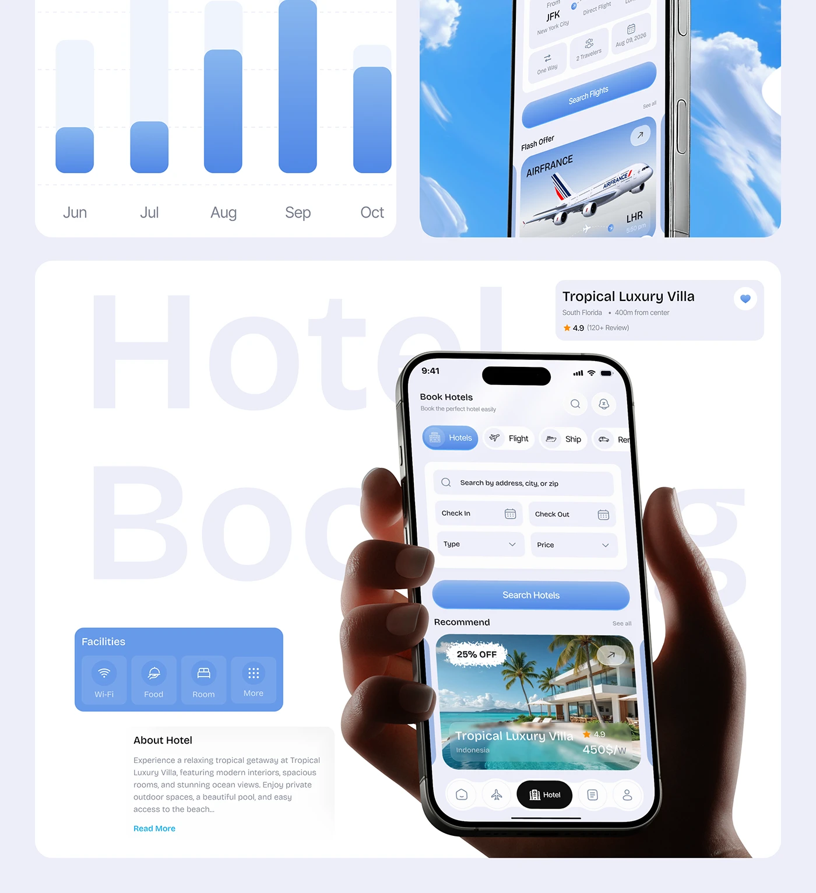

# Bars, Sky Phone and Hotel Booking Hand

**Discipline:** app ·  · **Design style:** Geometric & Bauhaus
**Tags:** bars, sky, ghost-type, hotel, hand, lavender, blue

## What it is
A lavender collage: a blue bar chart with faded tracks, a tilted phone against a sky, and a large tile with ghost 'Hotel Booking' lettering, a hand-held phone and floating cards for villa, facilities and description.

## What it means
Tiles mix data, atmosphere and product, and the floating cards explain the screen without clutter.

## Techniques
- Ghost lettering behind a held phone
- Floating info cards around the device
- Sky photograph as a tile background
- Faded track bars in the chart
- Blue facilities panel with icon tiles

## Best for
- Feature showcase pages
- Travel app case studies
- Bento-style presentations

## Vocabulary
- **Floating card** — A UI card placed outside the device to explain it.
- **Tile collage** — Rounded tiles of different content arranged together.
- **Track bar** — A faint bar showing the maximum behind a value.
