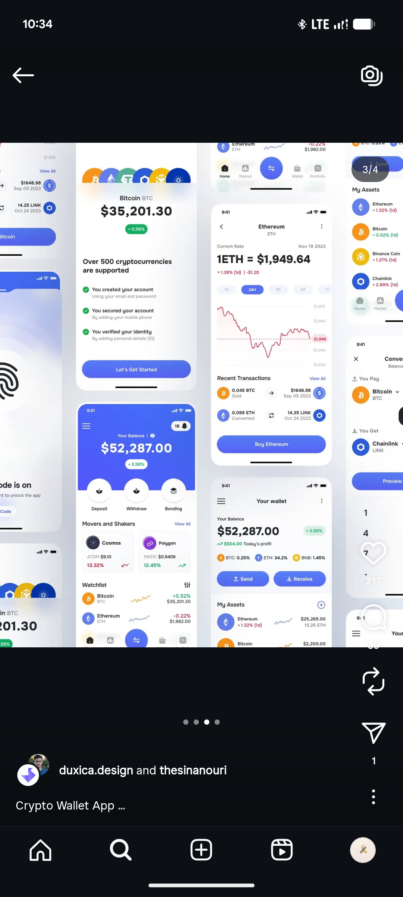

# Blue Crypto Wallet Screen Grid

**Discipline:** app ·  · **Design style:** Corporate & Clean-Tech
**Tags:** crypto, wallet, blue, grid, checklist, eth, chart, fade

## What it is
A dense grid of blue and white crypto wallet screens cropped at the edges: a Bitcoin price with an onboarding checklist and Let's Get Started button, an Ethereum rate page with a red line chart and range chips, a wallet home with Send and Receive, and a watchlist, with coin icon stacks across the tops.

## What it means
A tight collage of related screens sells the completeness of a kit, and the shared blue keeps it unified.

## Techniques
- Cropped dense grid of screens
- Green tick checklist for onboarding steps
- Time-range chips under a line chart
- Coin icon stack as a decorative header
- Blue primary buttons on every screen

## Best for
- Crypto UI kit previews
- Screen-grid overview images
- Blue and white fintech

## Vocabulary
- **Onboarding checklist** — A list of steps with ticks showing what has been completed.
- **Range chips** — Pills for switching a chart's time span.
- **Cropped grid** — A layout cut by the frame to imply more content.
