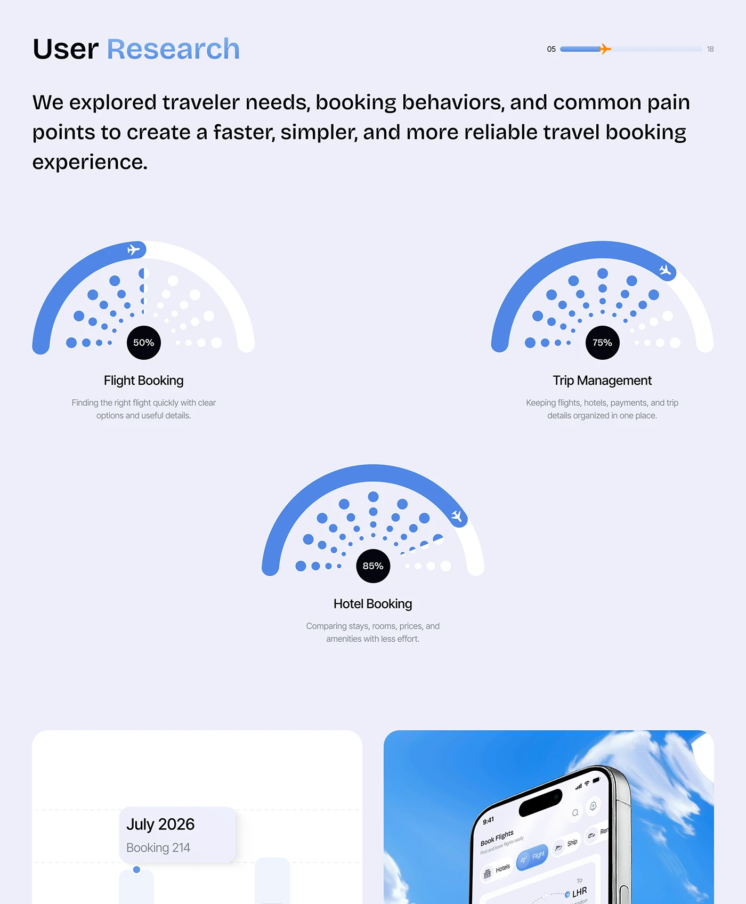

# Dotted Semicircle Gauges for User Research

**Discipline:** app · **Design type:** Research insight slide
**Tags:** research, gauges, dotted, blue, progress-bar, plane, lavender

## What it is
A lavender slide titled User Research with a plane on a progress bar, a paragraph, and three semicircle gauges made of a blue arc and radial dot fans with dark percentage discs (50%, 75%, 85%) labelled Flight Booking, Trip Management and Hotel Booking, with a chart tile and sky phone below.

## What it means
Radial dot fans make percentages feel like rays of a sun, and each gauge is labelled simply.

## Techniques
- Blue arc with an airplane marker at the end
- Radial fan of dots shrinking toward the centre
- Dark percentage disc at the gauge centre
- Three gauges arranged as a triangle
- Title with the second word in blue gradient

## Best for
- Research and metrics slides
- Travel product case studies
- Decorative percentage gauges

## Vocabulary
- **Dot fan** — Dots radiating from a centre in decreasing size.
- **Semicircle gauge** — A half-ring showing progress.
- **Value disc** — A small dark circle holding a number.
