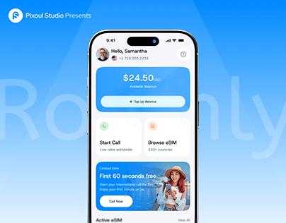

# Blue eSIM Calling App over Ghost Name

**Discipline:** app ·  · **Design style:** Gradient & Aurora
**Tags:** esim, calling, blue, ghost-type, balance-card, promo, cover

## What it is
A saturated blue cover with a giant faint 'Roamly' behind a phone showing a white home with a gradient balance card, Start Call and Browse eSIM tiles and a promo card with a traveller, and a studio presents line top left.

## What it means
Cobalt blue feels connected and global, and a bright gradient balance card is an obvious focal point.

## Techniques
- Ghost name behind the phone
- Gradient blue balance card
- Two quick-action tiles below the card
- Promo card with a photo cut-out
- Studio credit line in the corner

## Best for
- Telecom and travel utility apps
- Bold blue covers
- Wallet and balance-led home screens

## Vocabulary
- **Balance card** — A large card showing available funds.
- **Quick-action tile** — A tile giving fast access to a main task.
- **Presents line** — A studio credit introducing a project.
