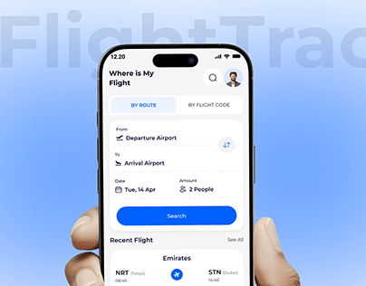

# Blue Flight Tracker Search in Hand

**Discipline:** app ·  · **Design style:** Gradient & Aurora
**Tags:** flight, blue, hand, ghost-type, search, white-ui, cover

## What it is
A pale blue gradient cover with giant faint 'FlightTrac' lettering and a hand holding a white phone showing a 'Where is My Flight' search form with route toggle, fields and a bright blue search button.

## What it means
A pure blue-and-white UI feels clear and trustworthy, and the ghost title adds depth.

## Techniques
- Ghost name cropped behind the phone
- Single bright blue for the primary button
- White cards on pale blue background
- Hand entering from the bottom
- Segmented tab for route or flight code

## Best for
- Flight tracking and travel apps
- Clean blue covers
- Utility app hero shots

## Vocabulary
- **Ghost title** — Oversized faint lettering behind a subject.
- **Segmented tab** — A two-option toggle at the top of a form.
- **Primary button** — The main coloured action on a screen.
