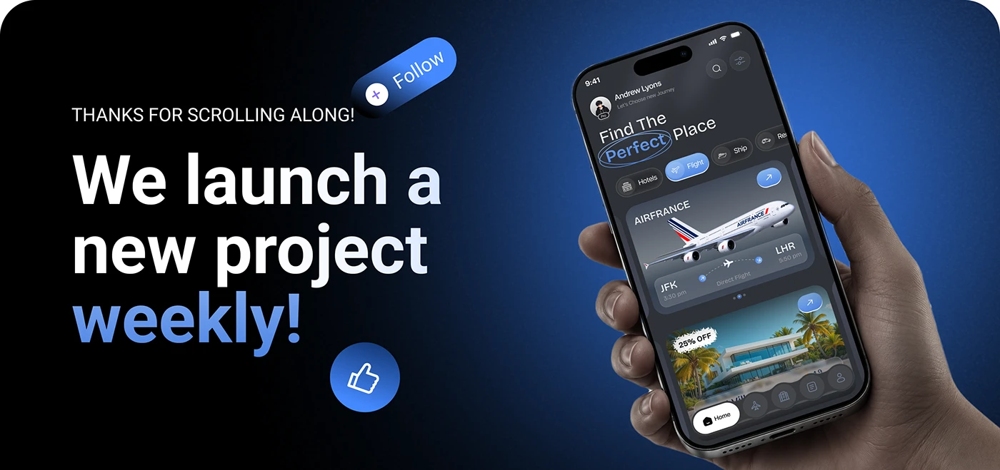

# Weekly Project Closing Banner

**Discipline:** app · **Design type:** Case study closing slide
**Tags:** closing, blue, gradient, hand, cta, follow, phone, thanks

## What it is
A wide closing banner with black-to-blue gradient, big bold sans 'We launch a new project weekly!' with 'weekly' in blue, a tilted Follow pill, a like button, and a hand holding a phone showing a travel app.

## What it means
It ends the case study with a direct, upbeat call to follow. Floating social buttons make the ask visual.

## Techniques
- Tilted follow pill as a playful CTA
- Blue-to-white gradient text for emphasis
- 3D like button floating in the space
- Hand with phone anchoring the right
- Dark-to-blue radial background

## Best for
- Case study endings
- Portfolio calls to action
- Social follow prompts

## Vocabulary
- **Closing slide** — The last frame of a case study with thanks and CTA.
- **Floating action** — UI elements like Follow rendered as objects in the scene.
- **Gradient text** — Type filled with a gradient rather than a flat color.
