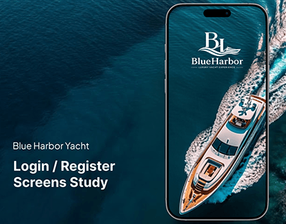

# Blue Harbor Yacht login study: aerial yacht wake on deep teal sea filling a phone

**Discipline:** app · **Design type:** Onboarding screens · **Design style:** Photographic & Cinematic
**Tags:** luxury, yacht, login, teal, aerial-photo, onboarding

## What it is
A deep teal ocean cover with 'Blue Harbor Yacht — Login / Register Screens Study' in white on the left and a phone whose splash screen shows an aerial yacht carving a white wake, with a serif 'BL' logo and 'BlueHarbor' wordmark.

## What it means
Luxurious and calm; the photo flows from background into the phone, so the brand feels seamless.

## Techniques
- Continue the background photo into the device screen.
- Use an aerial shot for drama and space.
- Keep the splash to logo and image only.

## Best for
- Luxury travel apps
- Login screen studies
- Premium splash screens

## Vocabulary
- **Splash screen** — The first branded screen shown on launch.
- **Aerial shot** — A photo taken from high above.
