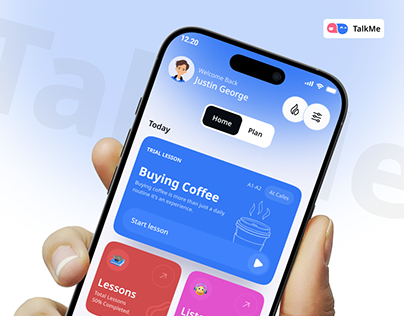

# Blue Language Lesson App in Hand

**Discipline:** app ·  · **Design style:** Geometric & Bauhaus
**Tags:** language, blue, hand, ghost-type, lessons, pink, cover

## What it is
A cover with a hand holding a phone showing a blue trial lesson card ('Buying Coffee') and red and pink lesson tiles, on a white to periwinkle gradient with faint 'TalkMe' lettering and a logo chip.

## What it means
Bold blue lesson cards look approachable and game-like, and the hand keeps it human.

## Techniques
- Large saturated blue card as the hero
- Line illustration of a coffee cup inside the card
- Red and pink tiles peeking from below
- Ghost brand name behind
- Pill segment control (Home, Plan)

## Best for
- Education and language apps
- Case-study covers
- Friendly consumer apps

## Vocabulary
- **Lesson card** — A card representing one course or unit.
- **Peek tile** — A card partly visible below the fold to invite scrolling.
- **Segment control** — A switch between two views.
