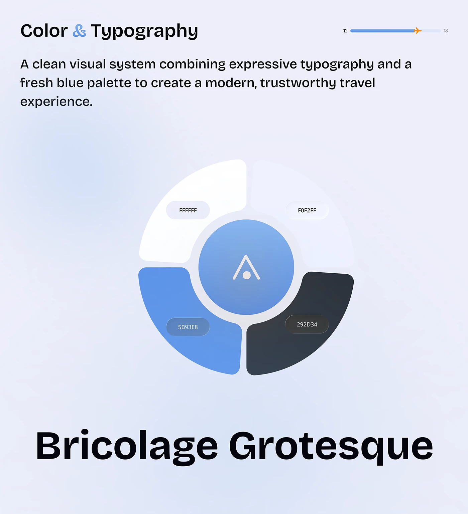

# Blue Palette Wheel and Bricolage Grotesque

**Discipline:** app ·  · **Design style:** Gradient & Aurora
**Tags:** palette, wheel, blue, typography, progress-bar, airy, travel

## What it is
A pale periwinkle slide with a title, a paragraph, a circular palette of four rounded quarter segments (white, ice, blue, charcoal) around a blue logo disc, and a huge black 'Bricolage Grotesque' specimen below.

## What it means
The ring turns a colour list into a single graphic object, and the huge typeface name makes the type choice unmistakable.

## Techniques
- Palette shown as a segmented ring with hex chips
- Logo sitting in the centre of the palette
- Plane icon riding a progress bar as page indicator
- Giant one-line specimen as the bottom anchor
- Soft radial blue glows in the background

## Best for
- Design-system colour and type slides
- Travel and trust-focused brands
- Portfolio case-study documentation

## Vocabulary
- **Palette ring** — Colours arranged as segments of a circle.
- **Progress indicator** — A bar that shows position through a document, here with a plane icon.
- **Specimen line** — A single line of text set large to display a typeface.
