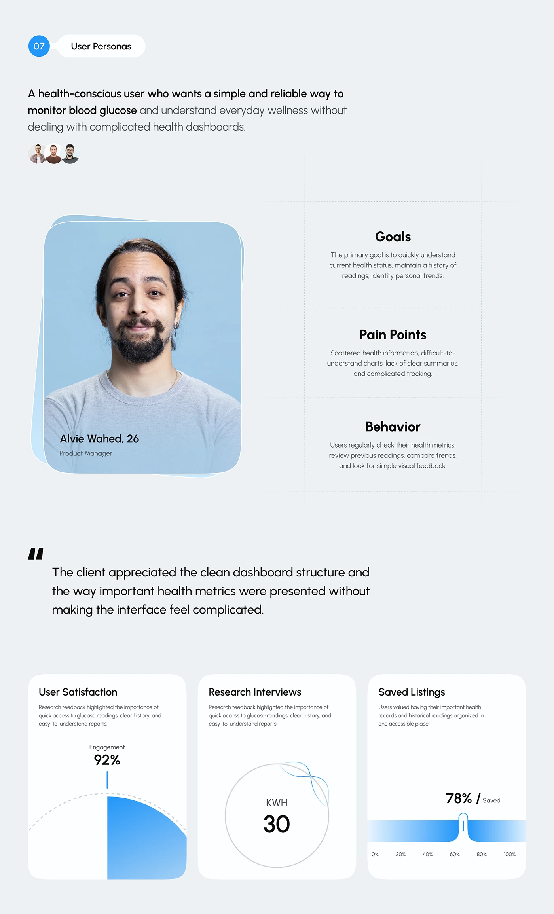

# Blue Persona with Metric Cards

**Discipline:** app · **Design type:** Research insight slide
**Tags:** persona, blue, cards, dashed-lines, gauge, quote, health

## What it is
A pale slide titled User Personas with a stacked-card portrait on blue, dashed-ruled Goals, Pain Points and Behavior blocks, a quote and three white metric cards with a half-disc, a ring and a gradient bar.

## What it means
Dotted rules and stacked photo cards feel neat and human, and the bright blue links everything.

## Techniques
- Stacked offset card behind the portrait
- Dotted lines dividing text blocks
- Centred headings with small grey descriptions
- Bold key phrase within a light sentence
- Varied mini charts in white cards

## Best for
- UX persona slides
- Health-tech case studies
- Research summaries

## Vocabulary
- **Stacked card** — Offset layers peeking from behind a card.
- **Dotted divider** — A dotted rule separating content blocks.
- **Numbered tag** — A circle with a number beside a section name.
