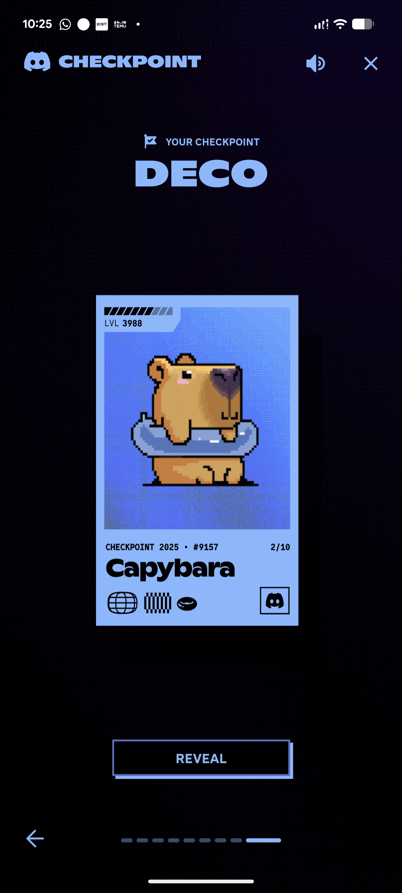

# Blue Pixel Capybara Collectible Reveal

**Discipline:** app ·  · **Design style:** Retro & Pixel
**Tags:** pixel-art, gamification, blue, collectible, card, reveal, retro

## What it is
A phone screenshot of a year-in-review reveal in navy and periwinkle: a heavy 'DECO' title, a periwinkle collectible card with a level bar and a pixel-art capybara in a swim ring, a black REVEAL button with an offset outline and dashed page progress.

## What it means
A single hue in pixel art and hard offset outlines makes a summary feel like unlocking a trading card, playful and rewarding.

## Techniques
- Collectible card with level bar, number and badges
- Pixel-art mascot on a dithered gradient
- Offset outline on the main button
- Dashed page-progress bar
- One hue on a near-black halftone ground

## Best for
- Gamified rewards and year-in-review screens
- Retro pixel-art UI
- Collectible card reveals

## Vocabulary
- **Reveal button** — A call to action that unveils a hidden reward.
- **Dither** — A pixel pattern that fakes gradients with dots.
- **Offset outline** — An outline shifted behind a shape as a hard shadow.
