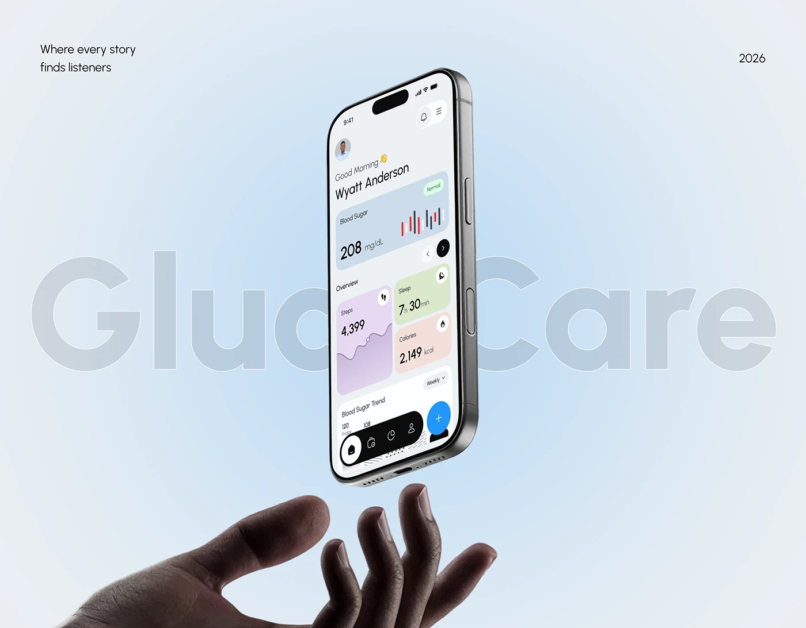

# Floating Health App Above an Open Hand

**Discipline:** app ·  · **Design style:** Minimalist
**Tags:** floating, hand, light-blue, ghost-type, health, tilted, minimal

## What it is
A pale sky-blue cover with a phone tilted in mid-air above an open hand, showing a health dashboard with pastel cards, and giant ghost 'GlucCare' lettering behind, with a tagline and year.

## What it means
Levitating the phone above a hand suggests care and support, and the pastel blue field feels clean and clinical yet soft.

## Techniques
- Device floating above a reaching hand
- Ghost brand name split by the phone
- Pastel card colours (blue, lilac, green, peach) for metrics
- Radial pale blue glow behind the subject
- Small tagline and date in the corners

## Best for
- Health and wellness apps
- Product hero images with a human gesture
- Soft-tone medical brands

## Vocabulary
- **Levitation** — Showing an object floating in space.
- **Pastel metric card** — A softly coloured card showing one health stat.
- **Corner captions** — Small text placed at the corners of a cover.
