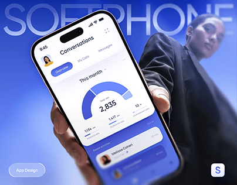

# Blue softphone app held in a low-angle hand shot over a giant outlined wordmark

**Discipline:** app ·  · **Design style:** Corporate & Clean-Tech
**Tags:** calls, blue, hand, low-angle, ghost-type, gauge, dashboard, project-cover

## What it is
A cobalt gradient cover with 'SOFTPHONE' in giant thin outlined letters behind, a woman in a black blazer lower right and a phone held toward the camera at a low angle. The screen shows conversations with a semicircle gauge (2,835), stat numbers and a recent call row. A pill 'App Design' and app icon sit in the corners.

## What it means
Modern and dynamic; the low angle and giant type make a utility app feel bold.

## Techniques
- Set an oversized outlined wordmark behind a person and device.
- Use a single blue gradient throughout, including the screen.
- Shoot the phone from below to add drama.
- Show a gauge as the hero data element.

## Best for
- Communication and productivity app covers
- Case-study thumbnails
- Single-hue blue brands

## Vocabulary
- **Outline ghost type** — Large letters drawn as thin outlines behind content.
- **Low-angle shot** — A photo taken from below, looking up.
- **Gauge hero** — A dial chart used as the main data visual.
- **Gradient cover** — A cover in one hue with tonal gradient.
