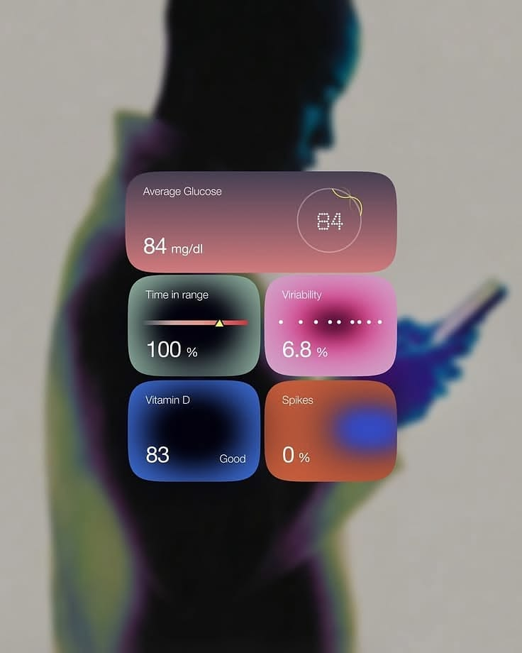

# Glucose Metric Tiles over a Blurred Silhouette

**Discipline:** app ·  · **Design style:** Glassmorphism
**Tags:** health, tiles, frosted, blur, glucose, gradients, widgets

## What it is
A blurred duotone silhouette of a person looking at a phone with five soft gradient widgets floating in front: Average Glucose in a rose gradient, Time in Range with a slider, Variability with a magenta glow, Vitamin D in blue and Spikes in orange with a blue blob.

## What it means
Soft radial gradients inside each tile make health numbers feel calm and organic, and the blurred person gives human context.

## Techniques
- Radial gradient glow inside each tile
- Bento of one wide and four small tiles
- Blurred photographic background
- Dot-matrix number in a ring
- Simple white labels and big numerals

## Best for
- Health widget design
- Glassmorphism dashboards
- Marketing images for health data

## Vocabulary
- **Gradient widget** — A small tile whose colour is a soft radial blend.
- **Dot-matrix numerals** — Numbers drawn from small dots.
- **Blurred silhouette** — A defocused figure used as a background.
