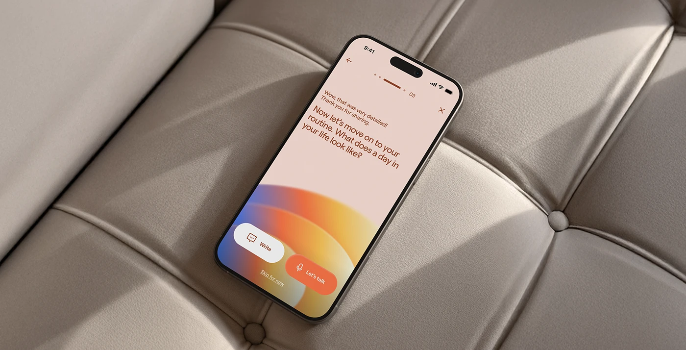

# Onboarding Question on Quilted Leather

**Discipline:** app ·  · **Design style:** 3D & Surreal
**Tags:** onboarding, blush, gradient-arc, leather, sofa, voice, top-down

## What it is
A top-down shot of a phone lying on a grey-taupe tufted leather sofa showing a blush onboarding screen with rust-coloured question text, a step indicator, a blue-to-orange gradient arc and Write and Let's talk buttons.

## What it means
Warm blush and rust tones match the soft leather, and the gradient arc is a gentle friendly focal point.

## Techniques
- Overhead angle on tufted leather
- Blush background with rust type
- Gradient arc rising from the base
- White and coral pill buttons
- Window light shadows across the sofa

## Best for
- Conversational onboarding screens
- Lifestyle and wellness apps
- Warm-toned mockups

## Vocabulary
- **Tufted leather** — Padded leather with buttoned indentations.
- **Step dashes** — Small dashes showing progress in a flow.
- **Voice option** — A button allowing the user to talk instead of type.
