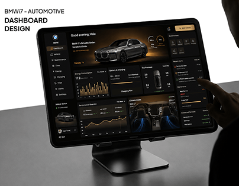

# BMW i7 automotive dashboard on a tablet stand: dark UI with orange energy charts and seat heating

**Discipline:** app · **Design type:** Dashboard · **Design style:** Dark & Neon
**Tags:** automotive, dashboard, dark-ui, orange, tablet, ev

## What it is
A tablet on a desk stand showing a dark car app: 'Good evening' header with the car photo, battery and charging gauges, orange bar charts of energy consumption, tyre pressure, a performance line chart and a climate view with blue-lit seats, with a finger tapping the screen.

## What it means
Premium and technical; amber accents on black echo a car's night-time instrument panel.

## Techniques
- Borrow the palette of real car interiors.
- Lead with a photo of the owner's vehicle.
- Use small multiples of charts in a card grid.

## Best for
- Automotive apps
- EV companion dashboards
- Connected device UIs

## Vocabulary
- **Small multiples** — Many small charts in a grid for comparison.
- **Companion app** — An app that controls or monitors a device.
