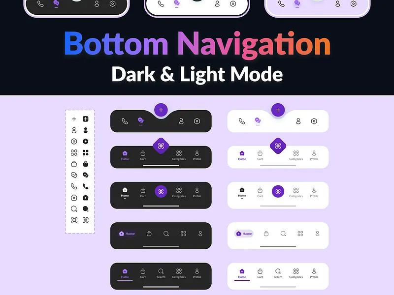

# Bottom Navigation Dark and Light Mode Set

**Discipline:** app · **Design type:** UI components
**Tags:** bottom-nav, dark-light, violet, lilac, fab, icons, gradient-title

## What it is
A lilac board titled with a blue to orange gradient 'Bottom Navigation Dark & Light Mode' showing five bar styles in black on the left and white on the right (curved notch with a plus button, diamond centre button, circular centre button, pill highlight, underline indicator) beside an icon sheet with outline and filled variants.

## What it means
Pairing dark and light versions and showing outline versus filled icons documents both themes and states at once.

## Techniques
- Five nav layouts in two themes
- Violet as the single accent
- Outline and filled icon pairs for inactive and active
- Gradient headline over black
- Notch and diamond centre buttons as variety

## Best for
- Bottom navigation component sets
- Light and dark theme documentation
- Icon state sheets

## Vocabulary
- **Notched bar** — A bar with a curved cut-out to cradle a centre button.
- **Filled/outline pair** — An icon in two styles for active and inactive.
- **Underline indicator** — A short line beneath the selected tab.
