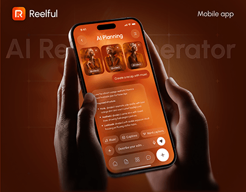

# Burnt Orange AI Reel App in Dark Hands

**Discipline:** app ·  · **Design style:** Warm & Organic
**Tags:** orange, brown, ai, video, hands, ghost-type, dark

## What it is
A cover with a phone in a burnt-orange UI (AI planning with portrait thumbnails and a prompt box) held by dark-skinned hands, with faint giant lettering behind and a logo top left.

## What it means
Monochrome orange-brown feels warm and creative. Skin tones and UI color harmonise into one glowing scene.

## Techniques
- Single hue for UI, background and lighting
- Faint oversized title behind the device
- Hands cropped in from the bottom for scale
- Grid overlay in the background
- Glowing screen as the light source

## Best for
- Creative and AI tools
- Portfolio covers
- Warm monochrome branding

## Vocabulary
- **Monochrome scene** — An image dominated by one hue.
- **Light source screen** — A device display appearing to illuminate its surroundings.
- **Grid overlay** — Subtle lines over the backdrop suggesting structure.
