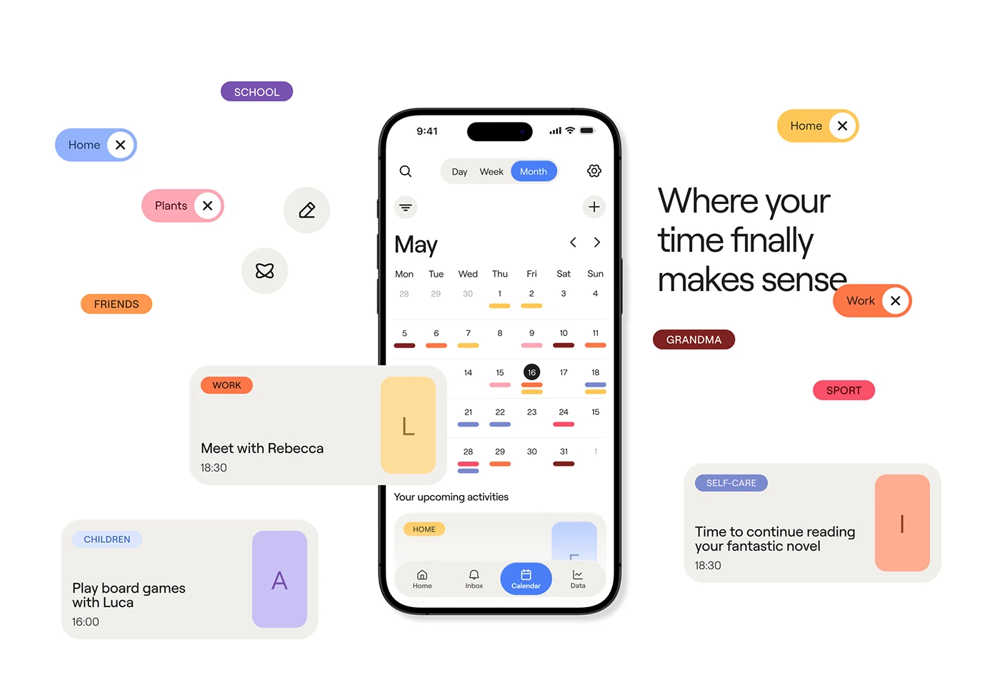

# Calendar App with Floating Category Tags

**Discipline:** app · **Design type:** Calendar and planner app
**Tags:** calendar, tags, cards, pastel, floating, white, month-view

## What it is
A white slide with a month-view calendar phone at centre surrounded by floating coloured tag pills (School, Home, Plants, Friends, Work, Sport, Grandma) and activity cards with big coloured letter blocks, plus a headline 'Where your time finally makes sense'.

## What it means
Colour-coded tags scattered around the phone show how categories carry through the app, and letter blocks give each card a friendly identity.

## Techniques
- Tag pills floating around the device as a visual system
- Colour-coded dashes on the calendar matching the tags
- Cards with large initial letters in coloured tiles
- White canvas so the colours pop
- Light large headline set beside the phone

## Best for
- Planner and organiser apps
- Explaining a colour system
- Feature explainers with floating UI parts

## Vocabulary
- **Exploded UI** — Interface parts pulled out and floated around the device.
- **Category tag** — A coloured pill classifying an item.
- **Letter tile** — A colour block with an initial used as an icon.
