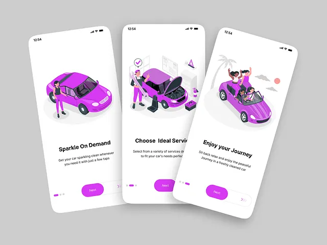

# Three white screens with flat purple illustrations: car wash on demand, choose a service and enjoy the journey

**Discipline:** app · **Design type:** Onboarding screens
**Tags:** onboarding, illustration, purple, white, flat, car, swipe-button, three-screens

## What it is
Three phones on grey tilted at angles, each with a flat isometric illustration in magenta and purple (a woman by a car, a mechanic with an open hood, friends in a convertible), a bold black title, a grey description, pager dots and a purple Next pill with a swipe arrow.

## What it means
Simple and friendly; consistent flat illustrations make services approachable.

## Techniques
- Use one purple illustration style.
- Place a bold title and short line under each.
- Use a pill Next with a swipe track.
- Tilt phones for energy.

## Best for
- Service booking app onboarding
- Illustration-led screens
- Purple brands

## Vocabulary
- **Isometric flat illustration** — A flat drawing in angled 3D view.
- **Swipe pill** — A button with a slider hint.
- **Pager dots** — Small dots showing steps.
- **Tilted phones** — Phones angled on a board.
