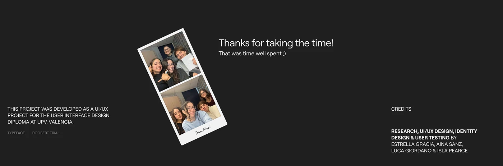

# Dark thank-you slide with photo-booth strip and credits

**Discipline:** app · **Design type:** Case study closing slide
**Tags:** closing-slide, dark, photo-booth, credits, case-study, student-project

## What it is
A charcoal slide with a tilted white photo-booth strip of a team, 'Thanks for taking the time!' at the top centre, and credit text at left and right in small caps.

## What it means
Personal and warm; the polaroid strip humanises a technical project.

## Techniques
- Use a photo-booth strip as a friendly sign-off image.
- Set a short human thank-you in large light type.
- Split credits and process notes to opposite sides.
- Tilt the photo slightly to break the grid.

## Best for
- Case study endings
- Student and team projects
- Credits and acknowledgements

## Vocabulary
- **Photo-booth strip** — A vertical strip of snapshot photos.
- **Credits block** — A list of contributors and roles.
- **Sign-off slide** — The last slide thanking the audience.
- **Tilted print** — A photo rotated a few degrees for informality.
