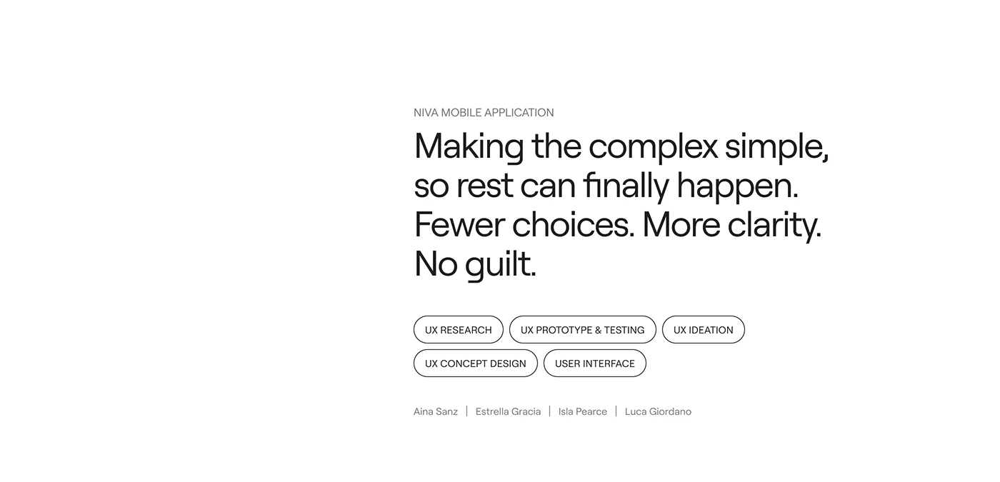

# White title slide with a large statement, outlined service pills and team names

**Discipline:** app · **Design type:** Case study intro slide
**Tags:** case-study, white, statement, outlined-pills, team, minimal, assistant-app

## What it is
A white slide with a small caps project label, a large sans statement 'Making the complex simple, so rest can finally happen. Fewer choices. More clarity. No guilt.', five outlined pills for UX disciplines and four team names separated by bars, on the right half.

## What it means
Quiet and confident; big words and outlined pills set the tone for the project.

## Techniques
- Place text on the right half leaving the left empty.
- Use outlined pills for services.
- Split sentences into short fragments.
- List team names with vertical dividers.

## Best for
- Case-study opening slides
- Minimal white decks
- Project credits

## Vocabulary
- **Outlined pill** — A capsule with a border only.
- **Half-page layout** — Content placed on one half of the slide.
- **Fragment statement** — Short sentence pieces.
- **Credits line** — Names separated by thin rules.
