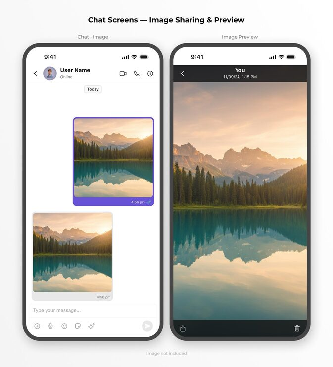

# Two phones: chat thread with shared lake photos and a full-screen image preview

**Discipline:** app · **Design type:** Chat interface · **Design style:** Minimalist
**Tags:** chat, messaging, image-sharing, preview, mobile, purple

## What it is
Two phone frames on white titled 'Chat Screens — Image Sharing & Preview': a chat with a user header, 'Today' chip, a sent photo in a purple bubble and a received photo in grey, and a dark full-screen preview of the mountain lake photo with share and delete actions.

## What it means
Clean and practical; one purple accent marks your own messages while photos stay the hero.

## Techniques
- Frame sent media in the accent colour and received in grey.
- Switch to a dark chrome for full-screen media.
- Keep header and composer icons minimal.
- Title paired screens as a flow.

## Best for
- Messaging apps
- Media-sharing flows
- UI kit presentations

## Vocabulary
- **Media bubble** — A chat bubble that holds an image.
- **Lightbox** — A full-screen overlay for viewing media.
