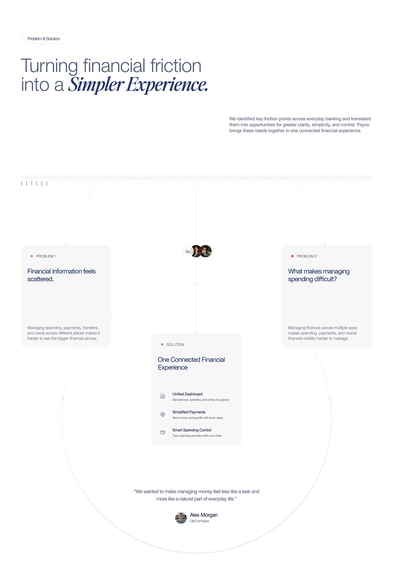

# Problem and Solution Cards on a Big Circle

**Discipline:** app ·  · **Design style:** Editorial
**Tags:** problem-solution, circle, ruler, serif-italic, cards, white, minimal

## What it is
A white slide with a mixed sans and italic serif headline, a ruler-tick line with dotted connectors down to two Problem cards and one central Solution card set inside a huge hairline circle, ending with a CEO quote.

## What it means
Connectors and the circle show problems funnelling into one answer, and hairline detail keeps it elegant.

## Techniques
- Dotted connectors from a ruler line to cards
- Problem cards flanking a central Solution card
- Huge hairline circle as a container
- Red and green square markers for problem and solution
- Quote with avatar at the bottom

## Best for
- Problem and solution slides
- Fintech case studies
- Minimal diagrams

## Vocabulary
- **Ruler line** — A line of tick marks used as a decorative scale.
- **Funnel layout** — A layout where several items lead into one.
- **Marker square** — A tiny coloured square labelling a card type.
