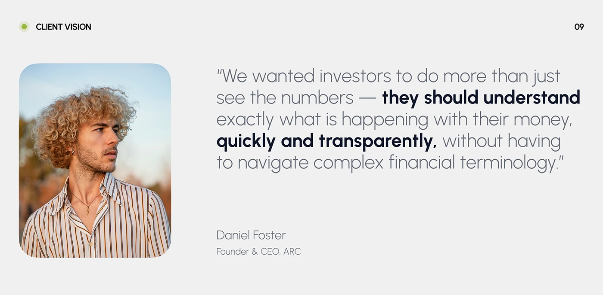

# Client vision quote with bold phrases and rounded portrait

**Discipline:** app · **Design type:** Case study intro slide
**Tags:** quote, testimonial, light-grey, portrait, two-tone-type, case-study

## What it is
A light grey slide with a rounded portrait of a curly-haired man at left and a large quote in light grey type where key phrases are dark bold. Name and title are below.

## What it means
Human, credible and clear; the bolded phrases summarise the quote at a glance.

## Techniques
- Bold selected phrases within a light quote so it can be skimmed.
- Pair a rounded-corner portrait with a paragraph.
- Use a small dot and section title at the top corner as a header.
- Keep the background very pale.

## Best for
- Case-study vision and testimonial slides
- Portfolios
- Brand presentations

## Vocabulary
- **Skim highlighting** — Bold phrases inside light text for quick reading.
- **Rounded portrait** — A photo with softly rounded corners.
- **Section marker** — A dot and label denoting a slide's topic.
- **Attribution line** — Name and role beneath a quote.
