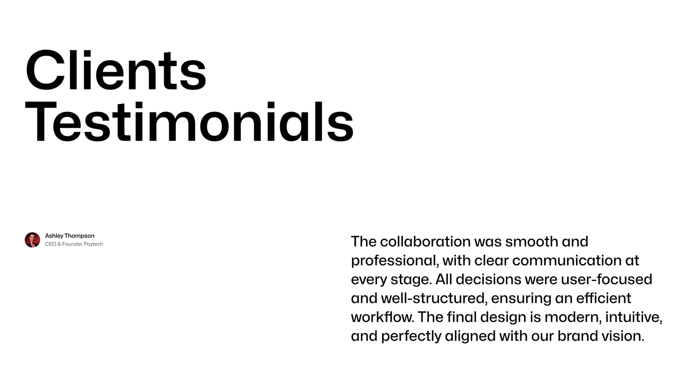

# Clients Testimonials Oversized Headline

**Discipline:** app · **Design type:** Case study closing slide
**Tags:** testimonial, white, black, oversized-type, avatar, minimal, quote

## What it is
A white slide with a huge black two-line 'Clients Testimonials' at top left and, at the lower right, a paragraph quote with a small avatar, name and title at the left.

## What it means
Very large heavy type against a small quote gives a strong hierarchy and an editorial feel.

## Techniques
- Giant heavy headline as the main graphic
- Small quote paragraph placed low right
- Tiny avatar with name at the opposite side
- Only black on white
- Extreme scale contrast

## Best for
- Testimonial slides
- Editorial case-study pages
- Typographic layouts

## Vocabulary
- **Scale contrast** — Placing very large and very small text together.
- **Diagonal balance** — Elements at opposite corners balancing the layout.
- **Testimonial slide** — A slide presenting a client's words.
