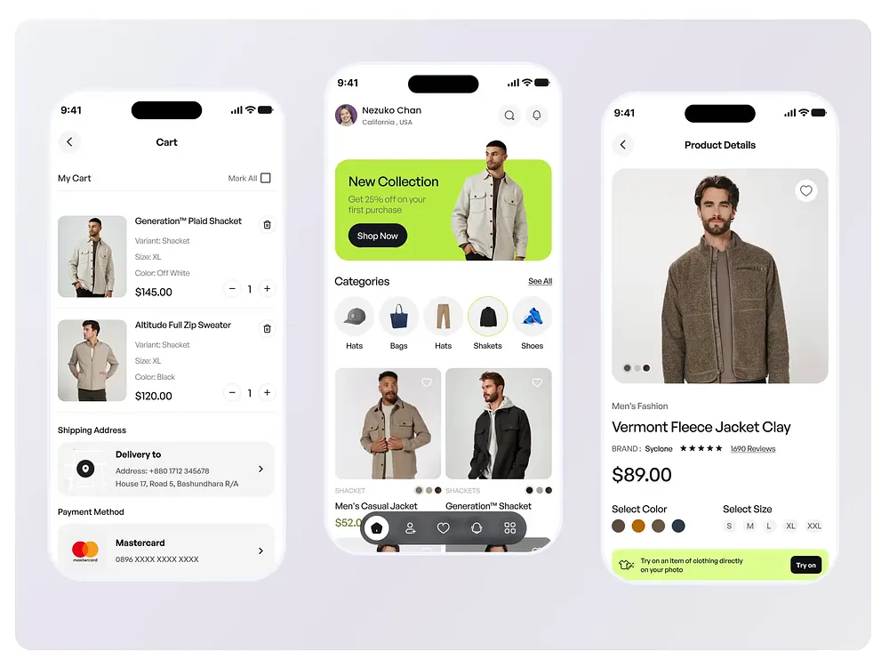

# Clothing Store Screens with Lime Accents

**Discipline:** app · **Design type:** E-commerce app
**Tags:** fashion, e-commerce, lime, white, three-phones, cart, product-detail

## What it is
Three white phones on a pale grey rounded panel: a cart with product rows, quantity steppers, shipping and payment cards; a home with a lime New Collection banner holding a model cut-out, circular category chips and a photo grid above a dark floating tab pill; and a product detail with a big photo, colour dots, size chips and a lime Try-on banner.

## What it means
Lime against clean white and neutral clothing photos feels fresh and confident, and a dark floating tab pill grounds the home screen.

## Techniques
- Lime banner with a cut-out model breaking its edge
- Circular category chips with one outlined selected
- Dark floating tab pill overlapping the content
- Colour dots and size chips as compact selectors
- Lime try-on strip at the base of the detail

## Best for
- Fashion and shopping app screens
- Light UI with one bright accent
- Cart, home and product flows

## Vocabulary
- **Try-on banner** — A strip inviting users to try an item virtually.
- **Category chip** — A round image button for browsing a category.
- **Stepper** — A minus and plus control for changing quantity.
