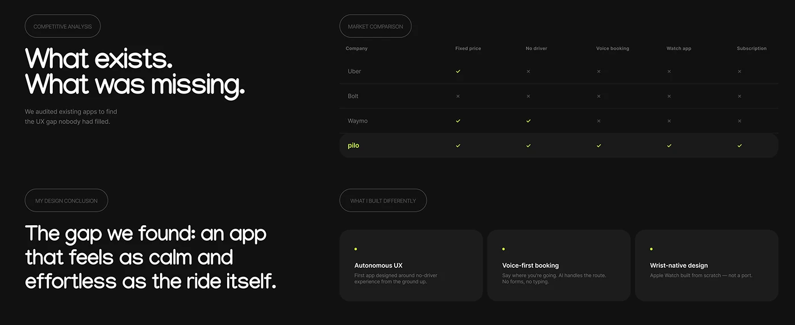

# Black 'What exists. What was missing.' slide with a market comparison table and three differentiator cards

**Discipline:** app ·  · **Design style:** Corporate & Clean-Tech
**Tags:** competitive-analysis, dark, lime, table, check-marks, cards, case-study, outlined-pills

## What it is
A dark slide with outlined pills, large white headings 'What exists. What was missing.' and 'The gap we found: an app that feels as calm and effortless as the ride itself.', a market comparison table of ride apps with check and cross marks where the brand row is highlighted in lime, and three dark cards (Autonomous UX, Voice-first booking, Wrist-native design) with lime dots.

## What it means
Clear and persuasive; a table with one lit row proves the gap.

## Techniques
- Highlight your row in the comparison table.
- Use check and cross icons.
- Set giant white statements on dark.
- Present differentiators as three dark cards.

## Best for
- Competitive analysis slides
- Dark case studies
- Differentiation storytelling

## Vocabulary
- **Comparison table** — A grid comparing products across features.
- **Highlighted row** — One row emphasised in a table.
- **Differentiator card** — A card stating a unique feature.
- **Design conclusion** — The takeaway from research.
