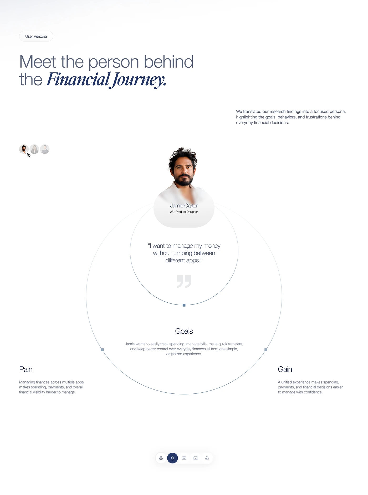

# Concentric Circle Persona Slide

**Discipline:** app · **Design type:** Research insight slide
**Tags:** persona, circles, minimal, serif-italic, white, quote, pain-gain

## What it is
A white slide with a mixed sans and italic serif headline, a persona portrait sitting on two large concentric hairline circles containing a quote and Goals text, with Pain and Gain blocks at the sides and an icon tab bar below.

## What it means
Circles place the person at the centre, and pain and gain flank them like a balance.

## Techniques
- Persona portrait cut out over a circle edge
- Concentric hairline circles as containers
- Pain and Gain placed left and right
- Square nodes on the circle line
- Mini avatar switcher and pill tab bar

## Best for
- Persona slides
- Minimal case-study documentation
- Research-to-design storytelling

## Vocabulary
- **Concentric circles** — Circles sharing a centre used to nest information.
- **Pain/gain** — Paired blocks describing frustrations and benefits.
- **Cut-out portrait** — A person masked from the background.
