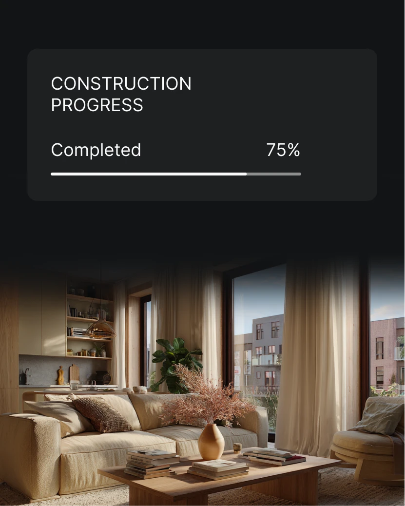

# Dark progress card melting into a warm interior photograph

**Discipline:** app ·  · **Design style:** Warm & Organic
**Tags:** progress, real-estate, dark, widget, photo-fade, warm-neutral, minimal

## What it is
A dark vertical composition. At the top a charcoal rounded card reads 'CONSTRUCTION PROGRESS', 'Completed 75%', with a thin white progress bar; below, a photo of a sunlit beige living room fades upward into the black.

## What it means
Reassuring and premium; the fade makes data feel connected to the real space it describes.

## Techniques
- Fade a photo into a dark background with a gradient so UI and image share one surface.
- Show progress as a single hairline bar with large numerals.
- Keep the card nearly the same tone as the background.
- Use warm natural photography to soften a technical readout.

## Best for
- Real-estate development and construction apps
- Project status widgets
- Premium dark UIs with photography

## Vocabulary
- **Photo fade** — An image dissolving into a solid colour with a gradient mask.
- **Progress hairline** — A thin bar showing completion.
- **Status widget** — A compact card summarising one metric.
- **Tonal card** — A card only slightly lighter than its background.
