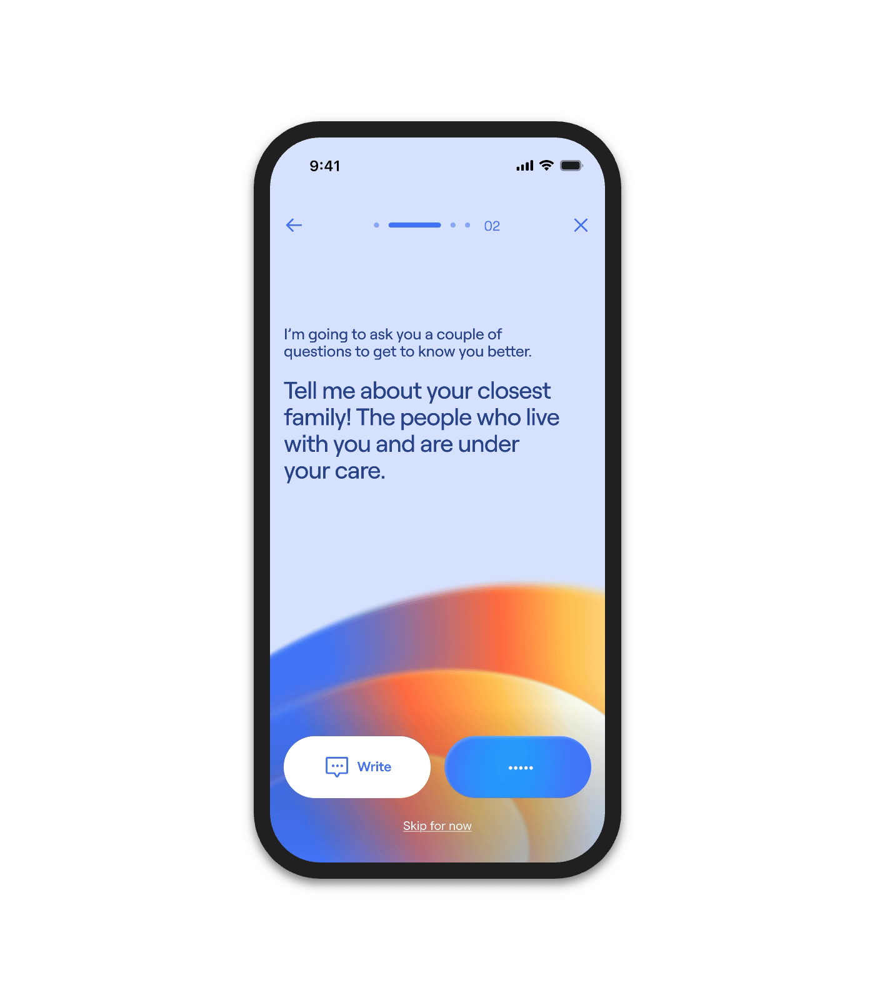

# Question screen with pale blue background and a blurred sunset arc at the bottom

**Discipline:** app ·  · **Design style:** Glassmorphism
**Tags:** onboarding, conversational, blue, gradient-arc, pill-buttons, progress-dots, large-question, ai

## What it is
A single phone with a lavender-blue screen, a slim progress indicator with '02', a small intro line and a larger question in navy, and a blurred blue, orange and cream arc rising from the bottom behind two pill buttons: a white 'Write' and a blue voice button, plus a Skip link.

## What it means
Warm and human; the glowing arc feels like a friendly presence asking the question.

## Techniques
- Use a blurred multi-colour arc as an ambient AI visual.
- Put a small intro line above a large question.
- Offer two answer modes (write or speak) as pills.
- Use tiny dot progress with a bold current segment.

## Best for
- Conversational and AI onboarding
- Wellness and family apps
- Single-question screens

## Vocabulary
- **Ambient gradient** — A soft colour glow used as decoration.
- **Dual input pills** — Two buttons offering different ways to answer.
- **Progress dots** — Small markers showing step position.
- **Skip link** — An underlined low-priority text action.
