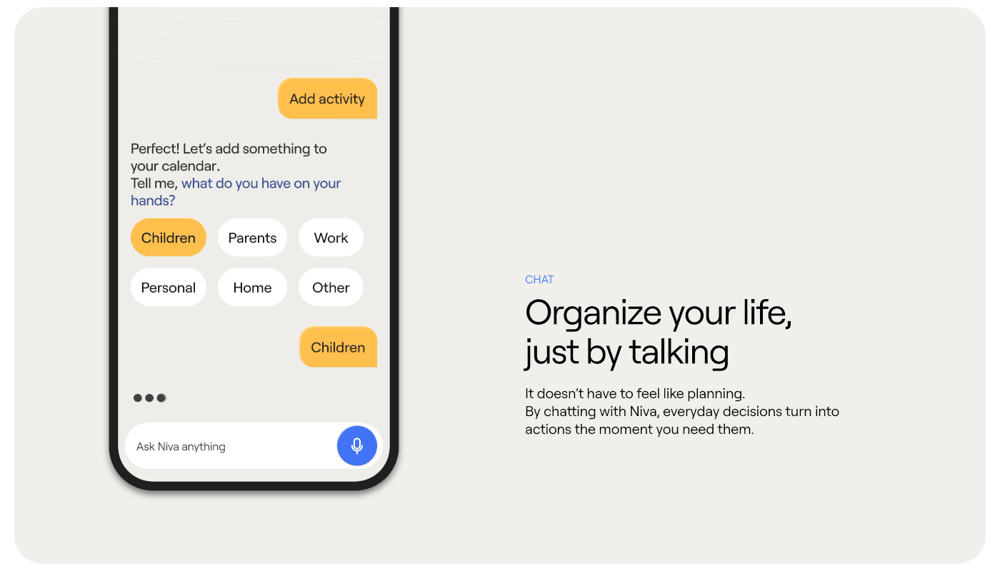

# Conversational planner with amber bubbles and suggestion chips

**Discipline:** app · **Design type:** Chat interface
**Tags:** chat, ai-assistant, amber, warm-grey, suggestion-chips, voice-input, case-study-slide

## What it is
A rounded warm-grey slide. A phone at left shows a chat where user replies are amber bubbles, the assistant text is plain, six chips (Children, Work...) offer quick answers and a white input has a blue mic button. Copy to the right reads 'Organize your life, just by talking'.

## What it means
Friendly and effortless; it turns planning into a chat instead of a form.

## Techniques
- Show assistant text without a bubble and user text in colour so the roles are distinct.
- Offer tappable suggestion chips instead of forcing typing.
- Use one warm amber for user actions and one blue for voice.
- Crop the phone off the top and left so the UI feels large and the copy has room.

## Best for
- AI assistant and voice apps
- Family and calendar organisers
- Feature explainer slides

## Vocabulary
- **Suggestion chip** — A tappable pill offering a quick reply.
- **Conversational UI** — An interface that works as a dialogue.
- **Cropped device** — A phone cut by the frame to enlarge the UI.
- **Voice button** — A microphone control for speaking input.
