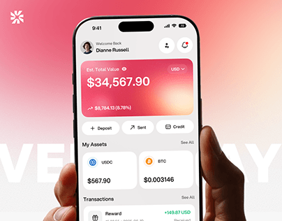

# Coral Gradient Crypto Balance in Hand

**Discipline:** app ·  · **Design style:** Gradient & Aurora
**Tags:** coral, pink, crypto, hand, balance, ghost-type, cover

## What it is
A cover with a hand holding a phone showing a coral-pink gradient balance card ($34,567.90), action buttons, asset tiles and a transaction row, over pale pink with ghost lettering behind.

## What it means
A glowing coral card is the focal point and feels friendly and warm for crypto. The hand keeps it human.

## Techniques
- Gradient card with a soft mesh as the balance hero
- Ghost lettering behind the device
- Hand entering from the right
- Pill buttons and small asset tiles below the card
- Logo mark top left

## Best for
- Crypto and wallet apps
- Warm gradient fintech branding
- Portfolio covers

## Vocabulary
- **Balance card** — A large card showing account value.
- **Mesh gradient** — An organic multi-colour blend.
- **Asset tile** — A small card for one holding, such as a coin.
