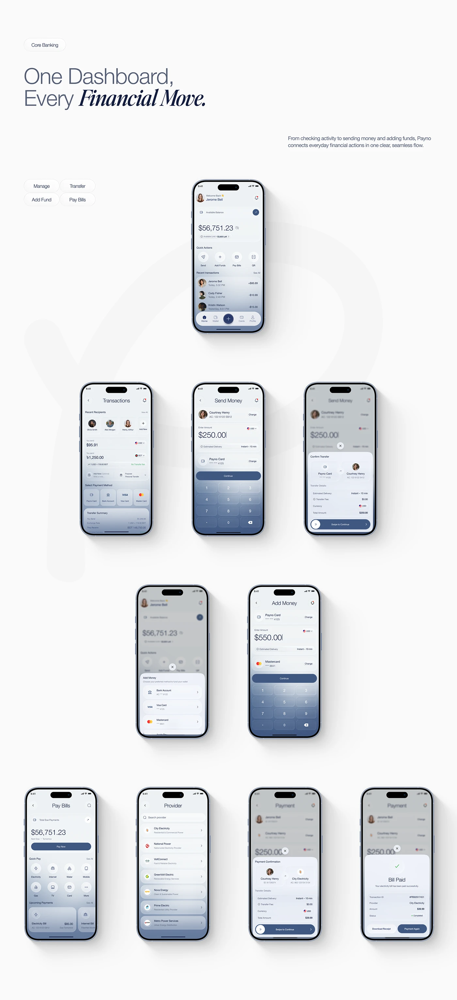

# Board of core banking screens on pearl-slate gradients: home, transactions, send money, confirm, add money, pay bills and payment success

**Discipline:** app · **Design type:** Fintech app screens
**Tags:** fintech, slate-blue, italic-serif, flow, keypad, bottom-sheet, phones, pill-tabs

## What it is
An off-white board with a pill 'Core Banking', a headline 'One Dashboard, Every Financial Move.' with bold italic serif, a right paragraph, four pill tabs and phones arranged in rows: a home, then transactions, send money and a confirm sheet, then add money and a keypad amount, then pay bills, provider list, payment confirmation and Bill Paid success.

## What it means
Orderly and calm; a consistent gradient and sheets show a whole payment flow.

## Techniques
- Arrange phones by flow row.
- Fade each screen from white to slate.
- Use bottom sheets for confirmation.
- Set a headline with italic serif emphasis.

## Best for
- Fintech flow presentations
- Payment and bill-pay screens
- Slate-blue app systems

## Vocabulary
- **Flow rows** — Rows of screens grouped by task.
- **Confirm sheet** — A bottom sheet showing transfer details.
- **Swipe to continue** — A slider control confirming an action.
- **Success screen** — A state confirming a completed payment.
