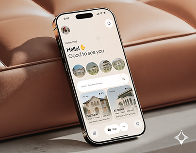

# Cream Real Estate App on Leather Sofa

**Discipline:** app · **Design type:** Device mockup scene
**Tags:** real-estate, cream, leather, tan, phone, warm, lifestyle

## What it is
A gold-framed phone leaning against tan leather cushions, showing a cream home screen with a friendly greeting, avatars of neighbourhoods, a search bar and property cards.

## What it means
The leather and warm cream palette suggest comfort and home. A tactile setting makes the app feel personal.

## Techniques
- Real-world furniture as a stage matching the product theme
- Warm neutral UI colours drawn from the scene
- Soft window light across the leather
- Phone leaning rather than lying flat
- Small logo bottom right as sign-off

## Best for
- Real estate and home apps
- Lifestyle app cover shots
- Warm-toned brand presentations

## Vocabulary
- **Thematic stage** — A physical setting chosen to echo the product's theme.
- **Leaning device** — A phone propped upright against an object.
- **Warm neutral** — A beige, cream or tan used as a base colour.
