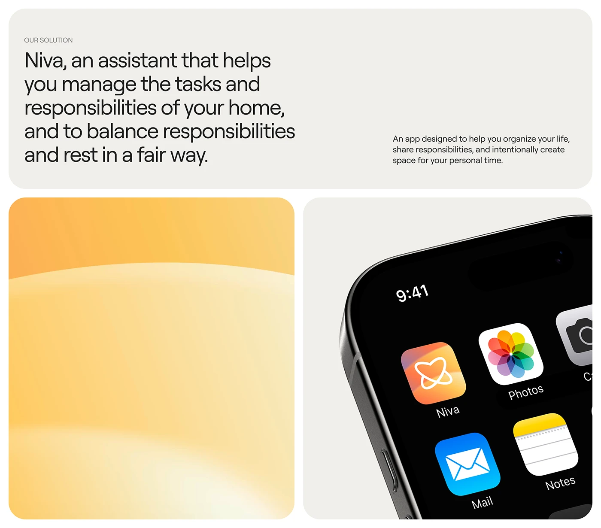

# Cream Solution Slide with Gradient Tile and Icon

**Discipline:** app ·  · **Design style:** Gradient & Aurora
**Tags:** solution, cream, yellow, gradient, app-icon, phone-corner, bento

## What it is
A cream board with a top tile of a large light headline about an assistant balancing home tasks, a tall tile of soft yellow to orange gradient, and a tile with a cropped black phone showing an orange gradient app icon beside Photos, Mail and Notes.

## What it means
A blank gradient tile acts as a breathing pause between text and product, and the cropped phone shows the icon in the wild.

## Techniques
- Blank gradient tile as a colour rest
- Large light headline with a small paragraph
- Phone cropped tightly showing the icon among system icons
- Cream base with rounded tiles
- Warm yellow-orange gradient echoing the icon

## Best for
- Solution statements in case studies
- App icon reveals
- Bento layouts with mixed content

## Vocabulary
- **Colour rest tile** — A tile with only a gradient, giving the eye a pause.
- **Icon in context** — An icon shown next to real system app icons.
- **Solution slide** — A slide summarising how the product solves the problem.
