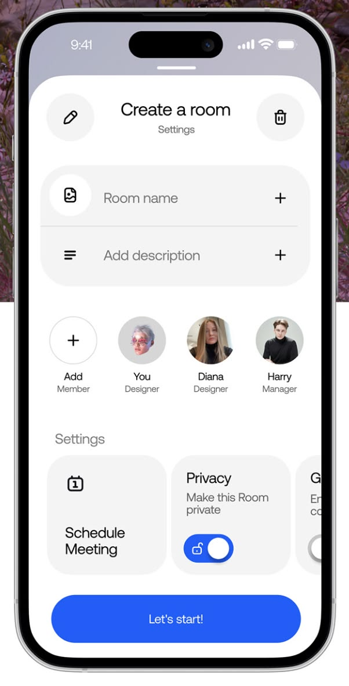

# Create a Room Settings Sheet

**Discipline:** app · **Design type:** UI components
**Tags:** settings, bottom-sheet, avatars, toggle, blue, form, white

## What it is
A close-up of a phone screen with a white sheet titled Create a room, edit and delete buttons, room name and description fields, a row of member avatars with roles, setting cards including a privacy toggle and a big blue Let's start! button.

## What it means
Big rounded controls and clear grouping make setup feel quick, and one blue button marks the primary action.

## Techniques
- Rounded grey field group with plus icons
- Member avatars with role captions
- Setting cards with toggles
- Single blue pill as the primary action
- Circular icon buttons on the header

## Best for
- Room and group creation flows
- Settings sheets
- Collaboration apps

## Vocabulary
- **Bottom sheet** — A panel sliding up from the bottom of a screen.
- **Setting card** — A card holding one option and its control.
- **Primary pill** — A full-width rounded button for the main action.
