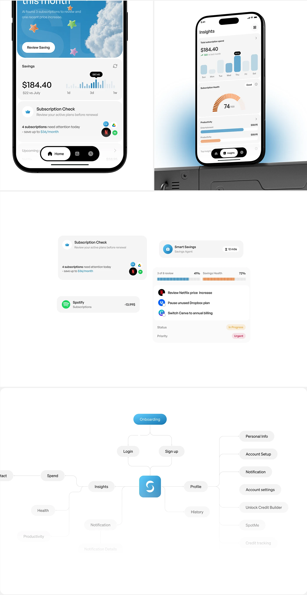

# Subscription App Screens, Cards and Flow Map

**Discipline:** app · **Design type:** UX documentation
**Tags:** subscriptions, screens, cards, flow-map, white, blue, nodes, fade

## What it is
A tall white sheet with two cropped phones (a blue cloud savings header with 3D stars and a savings chart, and an insights screen with bars and an orange gauge on a metal ledge), floating component cards, and a flow map of pill nodes radiating from the app icon with items fading at the edges.

## What it means
Cropped screens and extracted cards show detail and structure, and the fading map implies more depth.

## Techniques
- Cropped phones showing a screen fragment
- Component cards extracted and floated
- Radial flow map from a central icon
- Nodes fading toward the edges
- Blue as the primary accent with orange gauge

## Best for
- Subscription and finance case studies
- UI plus IA documentation
- Radial sitemap diagrams

## Vocabulary
- **Radial sitemap** — A map of screens radiating from a central node.
- **Extracted card** — A UI card copied out of a screen and enlarged.
- **Edge fade** — Elements fading toward the edge of a diagram.
