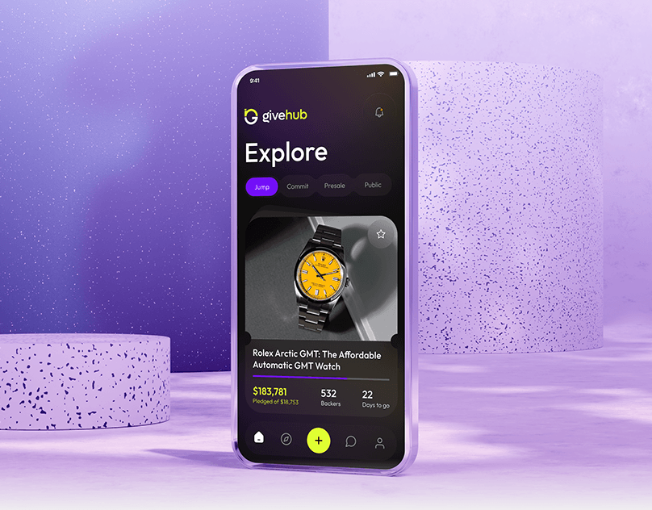

# Dark crowdfunding app on lilac terrazzo pedestals

**Discipline:** app · **Design type:** Device mockup scene
**Tags:** crowdfunding, dark-ui, lilac, terrazzo, 3d-scene, yellow-accent, mockup

## What it is
A glassy phone stands among lilac terrazzo cylinders. The dark screen shows 'Explore' with tab pills, a large product card with a yellow-dial watch, a purple progress bar, funding stats and a lime plus button in the nav.

## What it means
Premium and playful; a dark UI with neon accents pops against soft pastel props.

## Techniques
- Set a dark UI in a pastel 3D set for high contrast.
- Use terrazzo pedestals as a stage that suggests a showroom.
- Let one product image with a matching accent (yellow watch and lime) carry the screen.
- Use a lime FAB in the centre of the tab bar.

## Best for
- Marketplace, crowdfunding and product apps
- App launch visuals
- Dark UI presentations

## Vocabulary
- **Terrazzo** — A speckled surface texture used in props and backgrounds.
- **Pedestal stage** — Cylindrical platforms used to display a product.
- **FAB** — A floating action button.
- **Progress bar card** — A card showing funding progress.
