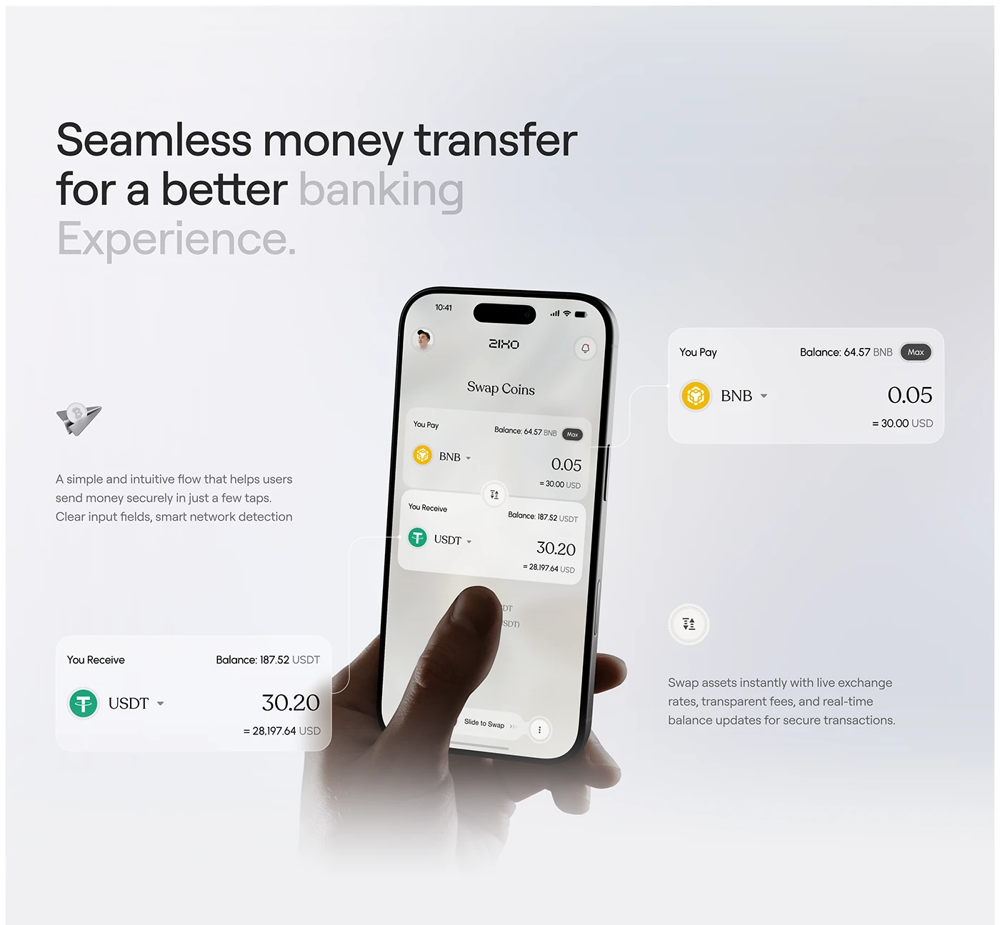

# Coin swap screen with hand and floating enlarged input cards on a pearl gradient

**Discipline:** app ·  · **Design style:** Glassmorphism
**Tags:** fintech, crypto, swap, pearl-gradient, exploded-ui, hand, light-ui, serif-numerals

## What it is
A pale grey pearl gradient with a large headline whose last words are faded grey. A hand holds a phone showing a swap screen; two large enlarged cards (You Pay BNB, You Receive USDT) float out on thin connector lines, with small captions and glyph icons.

## What it means
Clear and refined; the enlarged fields make the key interaction easy to understand.

## Techniques
- Enlarge important UI fields as floating cards connected by thin lines.
- Fade part of the headline to grey for emphasis.
- Use a pearly grey gradient background.
- Set numerals in a light serif.

## Best for
- Crypto and finance product explainers
- Feature callout presentations
- Elegant light UIs

## Vocabulary
- **Leader line** — A thin line linking a callout to its source.
- **Enlarged callout** — A magnified UI component beside the device.
- **Fade emphasis** — Dimming words to highlight others.
- **Pearl gradient** — A soft iridescent grey-white gradient.
