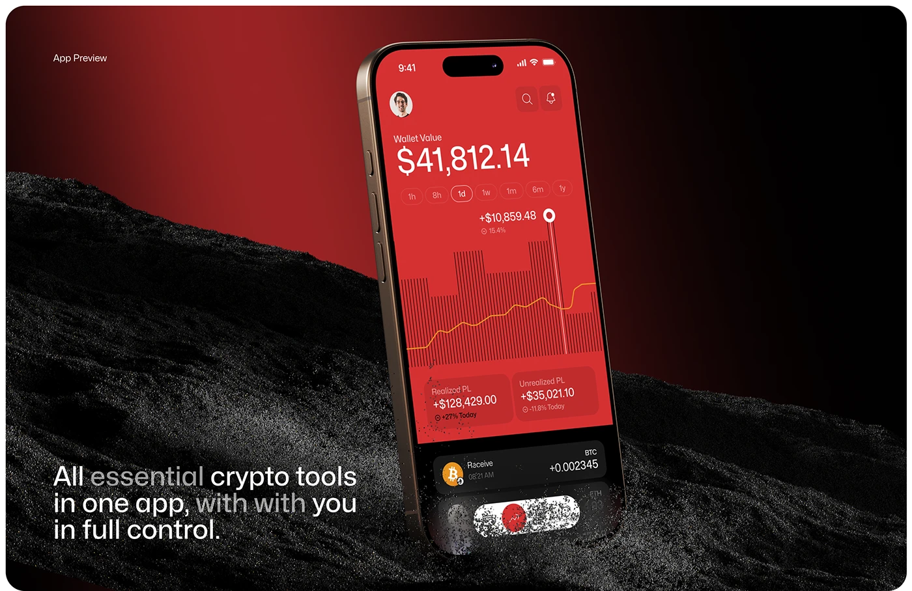

# Red Crypto Wallet on Black Gravel

**Discipline:** app ·  · **Design style:** Dark & Neon
**Tags:** red, black, crypto, 3d, texture, dramatic, phone

## What it is
A tilted phone with a full red wallet screen (large balance, bar-and-line chart) planted in a slope of black gravel, red gradient sky, and a tagline at lower left.

## What it means
Red-on-black feels bold and high-stakes, suiting money and risk. Physical grit adds realism and tension.

## Techniques
- One accent hue used for the whole UI and backdrop
- Rough natural texture against smooth UI
- Particles dissolving from the phone's base
- Striped bar-chart background behind a line
- Type with mixed weights and tones in the tagline

## Best for
- Crypto and trading apps
- Dramatic app preview shots
- Brands wanting an edgy identity

## Vocabulary
- **Particle dissolve** — Small fragments breaking away from an object's edge.
- **Textural contrast** — Setting smooth digital forms on rough material.
- **Accent immersion** — Using the brand color across both subject and backdrop.
