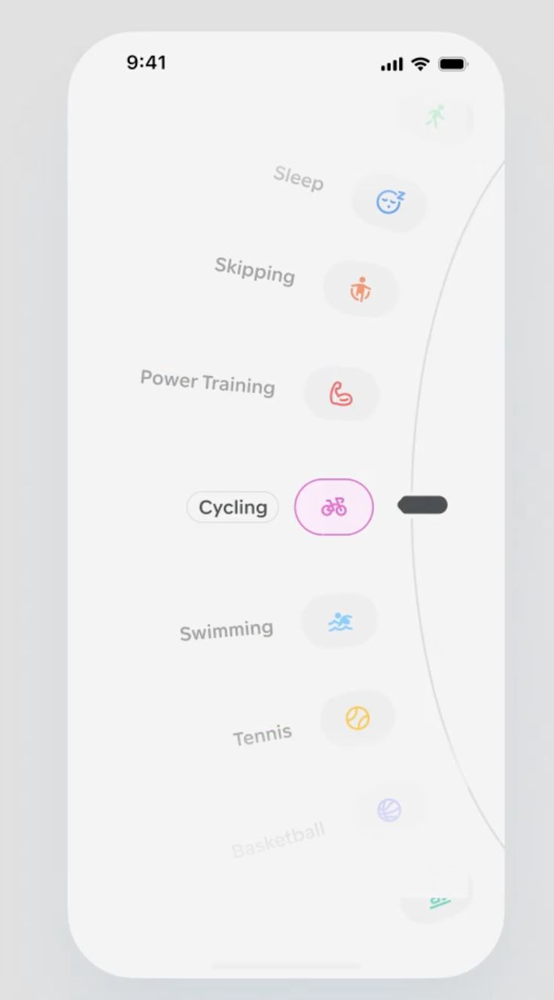

# Curved Activity Picker Wheel

**Discipline:** app · **Design type:** UI components
**Tags:** picker, curved, icons, activity, light, selection, depth-fade

## What it is
A light phone screen with a vertical arc of activity options (Sleep, Skipping, Power Training, Cycling, Swimming, Tennis, Basketball), each with a pastel icon tile, the selected Cycling highlighted in a pink pill and the rest fading out at top and bottom.

## What it means
Bending the list along an arc mimics a physical dial, making selection tactile and playful, with fading edges focusing on the centre.

## Techniques
- List bent along a circular path like a wheel
- Selected item enlarged and outlined in accent colour
- Items fade and shrink with distance from the centre
- Each option gets its own tiny pastel icon colour
- Grab handle on the arc's edge as an affordance

## Best for
- Fitness and activity selection
- Picker and dial interactions
- Playful onboarding steps

## Vocabulary
- **Wheel picker** — A selector where options rotate past a fixed focus point.
- **Depth fade** — Reducing size and opacity of items away from focus.
- **Affordance** — A visual cue that shows how something can be used.
