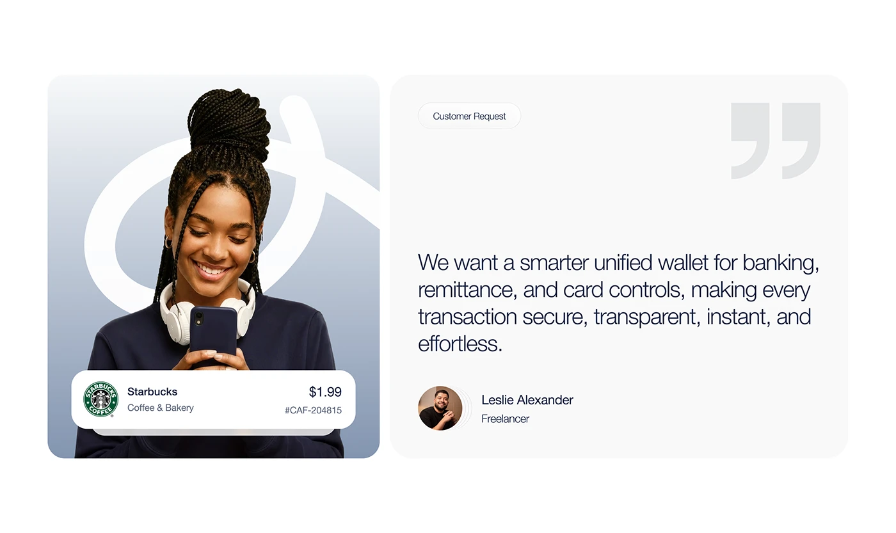

# Customer Request with Portrait and Quote Mark

**Discipline:** app ·  · **Design style:** Photographic & Cinematic
**Tags:** customer-request, portrait, quote, grey, gradient, wallet, serif-free

## What it is
A white page with two rounded panels: a blue-grey gradient panel with a giant white logo swirl and a smiling woman with headphones holding a phone, with a white transaction card at the base, and a pale panel with a Customer Request pill, huge grey quotation marks, a quote about a smarter unified wallet and an avatar with name and role.

## What it means
A photo panel and a quote panel side by side pair face and voice, and the giant logo swirl brands the photo.

## Techniques
- Two equal panels of photo and quote
- Giant logo swirl behind the portrait
- Transaction card overlapping the photo base
- Oversized quote marks in pale grey
- Avatar and role under the quote

## Best for
- Customer request and testimonial slides
- Fintech case studies
- Photo and quote pairings

## Vocabulary
- **Quote panel** — A panel holding a statement from a customer.
- **Logo swirl** — An oversized fragment of a logo used as a backdrop.
- **Overlay card** — A UI card placed over a photograph.
