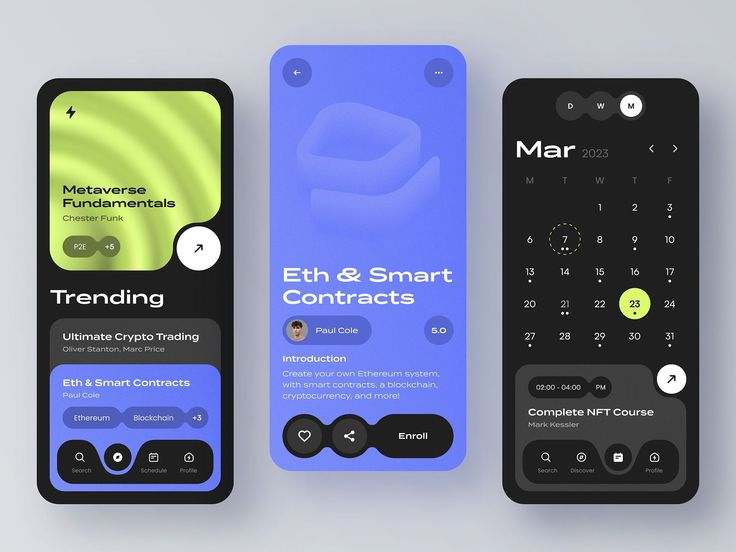

# Crypto Course App in Black, Lime and Blue

**Discipline:** app · **Design type:** E-commerce app
**Tags:** courses, crypto, black, lime, blue, three-phones, calendar, blob-cards

## What it is
Three phones on grey: a black screen with a lime wave-textured course card and a blue card with tags and pill nav, a periwinkle detail screen with a translucent 3D shape, a profile pill, a rating and Enroll and like buttons, and a black calendar screen with a lime selected date.

## What it means
Lime and periwinkle on black feel modern and techy, and joined blob shapes make cards and buttons feel liquid.

## Techniques
- Cards and buttons with joined blob notches
- Lime wave texture inside a card
- Periwinkle as a full-screen colour for the detail page
- Lime as the selected state in the calendar
- Pill nav with a raised active button

## Best for
- Course and education apps
- Crypto and tech learning
- Three-phone presentations

## Vocabulary
- **Blob notch** — A rounded cut joining a card to an adjacent button.
- **Wave texture** — A ripple pattern used as a gradient fill.
- **Selected date** — A highlighted day in a calendar.
