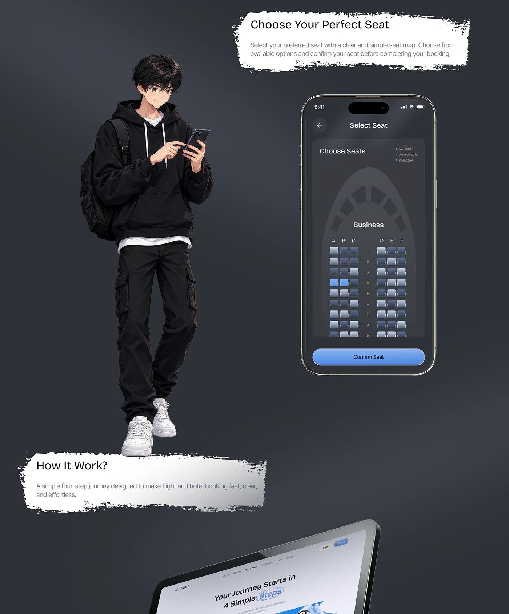

# Dark Seat Selection with Anime Traveller

**Discipline:** app · **Design type:** Travel app screens
**Tags:** seat-map, dark, brush-notes, illustration, anime, tablet, travel

## What it is
A dark slate slide with a torn white note 'Choose Your Perfect Seat', a dark phone showing an aircraft seat map with blue selected seats and a Confirm Seat button, an anime-style illustrated traveller in black holding a phone, a torn note 'How It Work?' and a tilted tablet peeking at the base.

## What it means
An illustrated character adds personality to a dark UI, and torn notes give an informal, crafted feel.

## Techniques
- Anime character as a mascot
- Torn white brush notes as headings
- Dark UI with blue selected seats
- Character overlapping a note edge
- Tilted tablet cropped at the bottom

## Best for
- Dark case-study slides
- Booking flow explanations
- UI plus illustration mixes

## Vocabulary
- **Seat map** — A diagram of seats a user can choose.
- **Character mascot** — An illustrated person representing the user.
- **Brush note** — A rough painted shape holding text.
