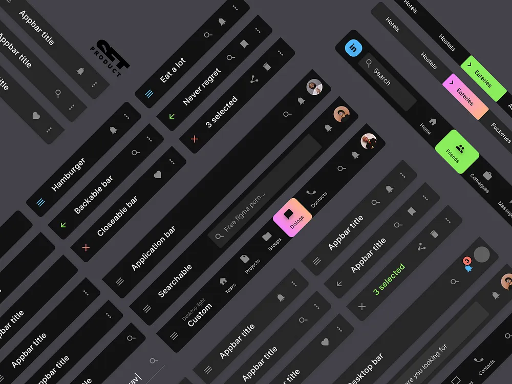

# Dark App Bar Variants in a Tilted Grid

**Discipline:** app · **Design type:** UI components
**Tags:** app-bar, dark, tilted, navigation, neon, components, catalog

## What it is
A dark grey field filled with tilted black app bars: titles like Hamburger, Backable bar, Closeable bar, Searchable, 3 selected and Custom with icons on the right, avatars, tab rows with a lime highlighted Friends tab and a gradient Dialogs tab, and a small logo mark.

## What it means
Rotating the whole catalogue creates a dynamic pattern, and small neon highlights show the selected states.

## Techniques
- Whole set rotated at an angle
- Black bars on dark grey
- Lime and gradient highlights for active tabs
- Coloured leading icons for actions
- Named variants as content

## Best for
- App bar component catalogues
- Dark UI kits
- Angled component presentations

## Vocabulary
- **App bar** — A top bar with a title and actions.
- **Selection mode bar** — A bar showing '3 selected' with contextual actions.
- **Component catalogue** — A visual list of variants of one component.
