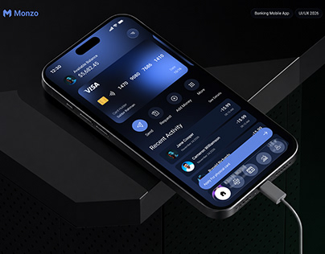

# Dark Banking App on Black Pedestal

**Discipline:** app ·  · **Design style:** 3D & Surreal
**Tags:** banking, dark, blue, pedestal, cable, dramatic, cover

## What it is
A dark cover with a phone tilted on angular black pedestals showing a navy banking home with a card and quick actions, a white charging cable trailing away, a logo at top left and metadata pills at top right.

## What it means
Angular black shapes and a single white cable give a moody, techy stage, and the blue UI glows.

## Techniques
- Black geometric pedestals as a stage
- White cable as a lone bright line
- Blue glow from the UI on a dark scene
- Metadata pills along the top
- Phone angled steeply for depth

## Best for
- Dark banking app covers
- Product renders with hard-edge props
- Tech-focused portfolios

## Vocabulary
- **Pedestal** — A block used to elevate a product in a scene.
- **Accent cable** — A cable used as a bright graphic line.
- **Metadata pill** — A small label giving category or year.
